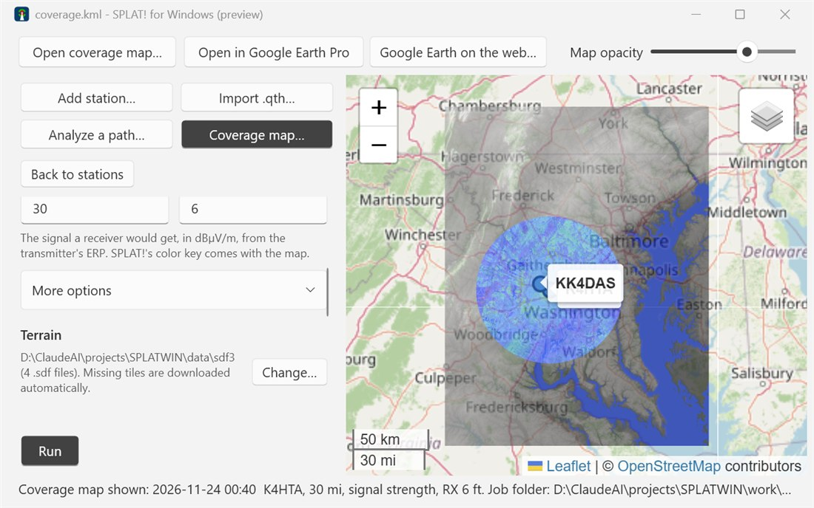
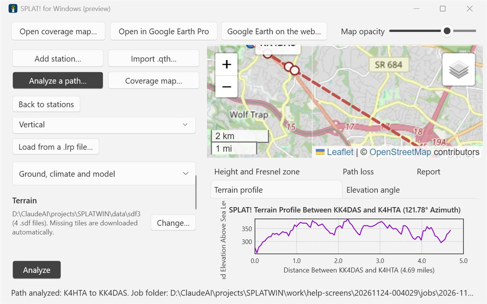

# SPLAT! for Windows

**Predict how a radio signal travels over real terrain, on Windows, with no command line.**
SPLAT! for Windows checks a path between two stations, or maps the coverage of a transmitter over
the area around it, and shows the results on a map, with a link out to Google Earth. It runs
**SPLAT!** 1.4.2, the RF signal propagation, loss and terrain analysis tool by John A. Magliacane,
KD2BD, ported to Windows and checked against SPLAT! on Linux: **it gives the same answers.**

## ⬇ Download

**[Get the latest release](https://github.com/kk4das/splat-windows/releases/latest)**, then
download the file named `SPLATforWindows-<version>-win64.zip` under **Assets**.

1. Unzip the whole zip to a folder of your own (not inside Program Files).
2. Double-click **`SplatForWindows.exe`**.

Nothing else to install: no admin rights, no .NET, no build tools. Windows 10 or 11, 64-bit. The
README.txt in the zip covers the rest, including the "Windows protected your PC" warning (the app
isn't code-signed) and how to remove the app. **You don't need to build anything from this
repository** unless you want to change the code.

> **0.9.0 is a preview** for club testing. Please tell KK4DAS what works, what doesn't, and what's
> confusing, or [open an issue](https://github.com/kk4das/splat-windows/issues).

## What it does



- **Stations without typing coordinates:** look up a call sign (free for US calls through
  callook.info, or worldwide with a QRZ.com XML subscription), type a street address or a
  Maidenhead grid square, or click the map. Drag a station's marker to put it exactly on the antenna.
  Your own SPLAT! `.qth` files can be imported.
- **Coverage maps:** signal strength, path loss or line of sight around a transmitter, drawn over a
  street or terrain map in the app, with an opacity slider. One click opens it in Google Earth Pro,
  or makes a file for Google Earth on the web.
- **Path analysis** between two stations: SPLAT!'s full report, with the terrain profile, height and
  Fresnel zone, path loss and elevation angle graphs.
- **Terrain is downloaded automatically** the first time an area is used (free public sources, no
  login). After that, areas already downloaded work offline.
- **Help built in:** press F1. A first-run setup and a Getting started guide take you to your first
  coverage map.



Every run is kept in its own folder under `Documents\SPLAT\Jobs`, with SPLAT!'s own files and a
`run-again.cmd` that repeats the same SPLAT! commands from the command line.

## Same answers as Linux SPLAT!

The port was tested against SPLAT! 1.4.2 built on Linux, on real terrain, before anything else was
built on it. Path reports match character for character, and coverage maps and terrain files are
byte-identical. The app is checked the same way: runs made through the app are compared with the
Linux results (`scripts\gui_path_equiv.ps1`, `scripts\gui_coverage_equiv.ps1`). Each release is
also tested on a clean Windows (Windows Sandbox) with nothing else installed. The evidence is in
[`reports/`](reports) and [`tests/results/`](tests/results).

---

## Using SPLAT! from the command line

The SPLAT! programs themselves are in the **`engine`** folder of the release zip: `splat.exe`,
`splat-hd.exe`, `srtm2sdf.exe` and `srtm2sdf-hd.exe`. They run on their own, with nothing else
installed. SPLAT!'s manual is in the zip's `docs\SPLAT` folder (and in
[`src/docs/english`](src/docs/english) here). It works as on Linux: you run it in a working folder
that holds your site files, and it writes its reports, graphs and maps there.

Put the engine folder on the PATH for the current PowerShell window (nothing is changed
permanently):
```powershell
$env:PATH = "C:\path\to\SPLATforWindows-0.9.0\engine;$env:PATH"
```

**Terrain.** SPLAT! needs an elevation (SDF) file for every square degree it covers. The app
downloads and converts these for you, into `%LOCALAPPDATA%\SPLATforWindows\Terrain`, and you can
point SPLAT! at that folder with `-d`. From a copy of this repository,
`scripts\get_terrain.ps1 -Lat 38.924 -Lon -77.206 -RadiusMiles 30 -Download -Convert` does the same
(add `-Hd` for the 1-arc-second tiles that `splat-hd` uses). **Missing terrain is silent in SPLAT!:**
an area with no SDF file is treated as sea level.

**Sites.** One `.qth` file per site: name, latitude, longitude, antenna height. **Longitude is
WEST-positive** (`-77.205793` from Google Maps is written `77.205793`), and **height is in feet**
unless you write `meters` after it. Path loss and coverage also need a `.lrp` file with the same name
as the transmitter (frequency, polarization, ERP and ground values; see
[`tests/cases/inputs/k4hta.lrp`](tests/cases/inputs/k4hta.lrp) and the manual). Avoid `_` in site
names: gnuplot shows it as a subscript in graph titles.

```
K4HTA
38.924216
77.205793
240.0
```

**Run it** from the working folder (`-d` is the terrain folder):

| What | Command | Output |
|---|---|---|
| Path report between two sites | `splat -t k4hta -r kk4das -d <terrain>` | `K4HTA-to-KK4DAS.txt` |
| + terrain profile and path-loss graphs | add `-p profile.png -l loss.png` | PNG graphs (needs gnuplot) |
| Coverage map (signal strength, 30 mi) | `splat -t k4hta -L 6 -R 30 -d <terrain> -o coverage.ppm -kml` | `coverage.ppm`, `coverage.kml` |
| Same in dBm instead of dBµV/m | add `-dbm` | |
| High resolution (1″ terrain) | use `splat-hd` with 1″ terrain | |

`-L 6` means "receiver antenna 6 ft above ground". **The number is required:** with `-L` alone,
SPLAT! silently skips the calculation and draws only grey terrain and blue water. The same is true
of `-c`. Run `splat` with no arguments for every option.

- **Graphs** (`-p`, `-e`, `-h`, `-l`, ...) need gnuplot on the PATH. (The app draws its graphs
  itself and doesn't need it.)
- **Maps** are `.ppm` files, which Windows can't open. `scripts\ppm2png.ps1 coverage.ppm` (in this
  repository) converts one to PNG, and with `-kml` also writes a `.kmz` for Google Earth. SPLAT!'s own
  `.kml` points at the `.ppm`, which Google Earth can't show.
- To avoid typing `-d` each time, put the terrain folder's path on the first line of
  `%USERPROFILE%\.splat_path`.

### Differences from Linux SPLAT!
- **Terrain file names use `_` instead of `:`** (`38_39_77_78.sdf`), because Windows forbids `:` in
  file names. SDF files made on Linux must be renamed; their contents are identical.
- **The settings file is `%USERPROFILE%\.splat_path`** (`$HOME/.splat_path` on Linux; `HOME` is
  still used if it's set).
- **Text reports have Windows (CR-LF) line endings.** The content is identical.
- Unchanged from upstream: `-kml` and `-geo` together produce **neither** file. Use one or the other.

---

## Building from source

Most people don't need this: the [release zip](https://github.com/kk4das/splat-windows/releases/latest)
has everything built.

- **SPLAT! engine:** `.\build.ps1` builds it into `dist\` with MSYS2 (UCRT64: GCC, bzip2, zlib) at
  `C:\msys64`. The finished `.exe` files need nothing from MSYS2.
- **The app:** C#/.NET 10 WPF, in [`gui/`](gui). `gui\build-gui.ps1` builds, tests and publishes it.
  `scripts\make_package.ps1` makes the release zip.
- **Checks:** `scripts\run_cases.py` then `scripts\compare_outputs.py --last-digit` compare the port
  with the Linux reference results. Every change to the port must still say **EQUIVALENT**. The app
  has window tests (`scripts\gui_*_uitest.ps1`) and the Linux-equivalence gates above.
- [`splat-windows-runbook.md`](splat-windows-runbook.md) records how the project is run, every
  decision and its history; [`reports/`](reports) has one report per stage.

## License and credits

Free software under the **GNU General Public License, version 2** ([`src/COPYING`](src/COPYING)),
with NO WARRANTY, like SPLAT! itself. If you pass the programs on, pass on the source (this
repository) too.

SPLAT! by John A. Magliacane, KD2BD, and its contributors; the ITWOM propagation model by Sid
Shumate. Maps by Leaflet (BSD license), map data © OpenStreetMap contributors and OpenTopoMap
(CC-BY-SA); terrain from SRTM data via viewfinderpanoramas.org and the AWS open terrain tiles.
Windows port and app by KK4DAS.
